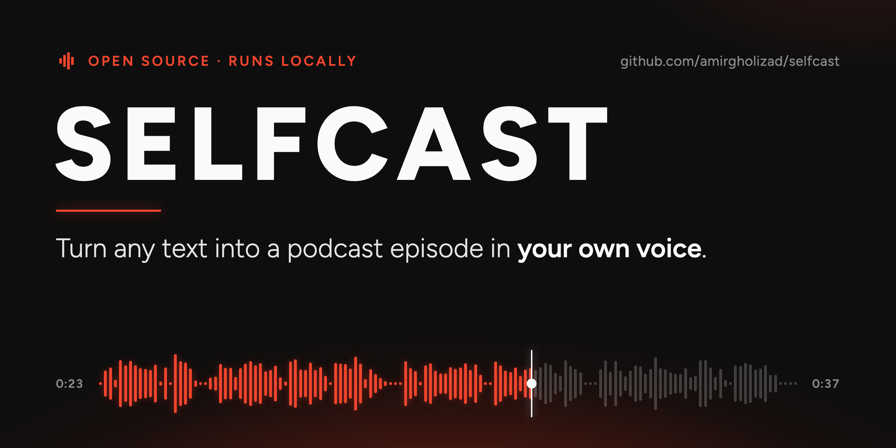

[](https://amirgholizad.github.io/selfcast/)

# Selfcast

Turn any text into a podcast episode in **your own voice**. Record yourself talking for a
minute, and Selfcast clones your voice once. After that, hand it a script and get back a
finished, podcast-ready MP3.

Everything runs on your own computer. No cloud APIs, no accounts, no uploads: your voice
never leaves your machine. It's built on [Chatterbox](https://github.com/resemble-ai/chatterbox)
by Resemble AI, and it comes with [Claude Code](https://claude.com/claude-code) skills, so
making an episode can be as short as `/podcast my-script.md`.

**[Listen to a demo](https://amirgholizad.github.io/selfcast/)** · [Requirements](#requirements) · [Claude Code skills](#using-it-with-claude-code) · [MIT licensed](LICENSE)

The [demo](https://amirgholizad.github.io/selfcast/) is 37 seconds of my own voice, cloned from
one minute of recording and generated on a MacBook Air M4. Nothing was edited by hand.
([MP3](docs/demo.mp3))

```text
$ uv run selfcast podcast --file scripts/example.md
Voice 'me' | engine turbo | power eco | 10 chunks, ~208 words (~1.4 min of audio)
[  1/10]   1.6s audio in   3.7s | ETA 5m 03s | The Two-Minute Rule.
[  2/10]   3.5s audio in   4.8s | ETA 2m 40s | Welcome to the very first episode. I'm really glad you're he...
...
Done in 2m 10s: podcasts/2026-11-27-the-two-minute-rule/2026-11-27-the-two-minute-rule.mp3  (1m 18s long)
```

## Features

- **Clone once, reuse forever.** Cloning takes about 30 seconds and saves your voice as a small
  profile. Every episode after that reuses it.
- **Fully local.** Uses the Apple GPU on Apple Silicon Macs (CUDA on NVIDIA machines). The model
  weights download once (~2.8 GB), and after that it works offline.
- **Light on your laptop.** The default *eco* mode runs at low priority on 2 CPU threads, with a
  GPU memory cap and short rests between sentences. A render peaks at about 7 GB of memory on a
  16 GB MacBook Air, and that doesn't grow with the length of the episode.
- **Write scripts in Markdown.** Headings, lists, `[pause 2s]`, author notes that aren't read
  aloud, and expressive tags like `[laugh]`, `[sigh]` and `[whispering]`.
- **Podcast-ready output.** 44.1 kHz MP3 at -16 LUFS (the usual podcast loudness), peaks limited
  to -1 dBFS, with title, show and artist tags, and chapters from your `##` headings.
- **Fix one sentence, not the whole episode.** Every episode comes with a chunk map of timestamps.
  Re-take only the line that sounds off, or edit the script: unchanged sentences come from a cache.
- **Listens to itself.** Every sentence is transcribed with Whisper (locally, on the CPU) and
  compared with the script. A take that drops a letter ("CS" for "C S S"), slurs words together,
  or comes out much too long or short is regenerated automatically. Anything still off is flagged
  with what was heard, so you know where to listen.
- **Watermarked.** Output carries Resemble AI's inaudible [Perth](https://github.com/resemble-ai/perth)
  watermark, so it can be identified as synthetic.

## Requirements

Selfcast was built and tested on a **MacBook Air M4 with 16 GB of RAM, running macOS 26**.

| Platform | Status |
| --- | --- |
| Apple Silicon Mac (M1-M4), 16 GB+ | **Supported.** Tested on M4 / 16 GB. Uses the Apple GPU (MPS). |
| Apple Silicon Mac, 8 GB | Untested. Turbo peaks at ~7 GB, so close other apps first and expect some swapping. |
| Intel Mac | **Not supported.** Chatterbox needs PyTorch 2.6, which has no Intel macOS builds. |
| Linux or Windows with an NVIDIA GPU | Should work (CUDA is picked automatically) but is untested. |
| Linux or Windows, CPU only | Should work but is untested, and will be slow. |

You also need:

- **[uv](https://docs.astral.sh/uv/)**. It installs the right Python (3.11) and every dependency for you.
- **[ffmpeg](https://ffmpeg.org/)** with MP3 support (standard builds have it).
- **About 4 GB of free disk:** ~2.8 GB of model weights (in `~/.cache/huggingface`) plus ~1.1 GB for the Python environment.

```sh
# macOS
brew install uv ffmpeg

# Windows
winget install astral-sh.uv Gyan.FFmpeg

# Linux: install ffmpeg with your package manager, then
curl -LsSf https://astral.sh/uv/install.sh | sh
```

## Quick start

1. Clone the repo (or fork it first if you want to make changes), then install:

   ```sh
   git clone https://github.com/amirgholizad/selfcast.git
   cd selfcast
   uv sync
   ```

2. **Record yourself** for 30-60 seconds and put the file in `recordings/`. Any format works,
   including a Voice Memos `.m4a`. If you don't know what to say, read the passage in
   [`recordings/README.md`](recordings/README.md). See [Recording tips](#recording-tips).

3. **Clone your voice** (one time):

   ```sh
   uv run selfcast clone --recording recordings/my-voice.m4a --name me
   ```

   The first run downloads the model weights. Then listen to `voices/me/preview.mp3`.

4. **Make an episode:**

   ```sh
   uv run selfcast podcast --file scripts/example.md
   ```

   The episode lands in `podcasts/<date>-<title>/`.

## Using it with Claude Code

The repo ships two [Claude Code](https://claude.com/claude-code) skills in `.claude/skills/`.
Open the folder in Claude Code and:

- **`/clone-voice`** checks your recording, clones it, and walks you through listening to the preview.
- **`/podcast`** takes a script file or pasted text and renders the episode in the background. Then
  just say "the part at 0:42 sounds off" and it re-takes only that sentence.

The skills call the same `selfcast` command described below, so you can switch between them freely.

## Writing scripts

Scripts are plain text or Markdown. Everything below is optional.

| Write | You get |
| --- | --- |
| A blank line | A paragraph break (a longer pause) |
| `# Heading` | Read as its own phrase, with a pause before and after. The first heading becomes the episode title. |
| `## Heading` | Also starts a chapter (see below) |
| `- item` or `1. item` | Each item read as its own phrase |
| `[pause]` or `[pause 2.5s]` | A pause (default 1 s, max 10 s) |
| `---` | A 1.5 s scene break |
| `<!-- note -->` | A note to yourself, never read aloud |
| `[laugh]` `[chuckle]` `[sigh]` `[gasp]` `[clear throat]` `[whispering]` `[dramatic]` `[happy]` `[sarcastic]` `[surprised]` | Expressive delivery (turbo engine only) |

Link text is read and URLs are dropped. Bare URLs and code blocks are skipped. See
[`scripts/example.md`](scripts/example.md) for a sample.

### What gets read

Before anything is spoken, Selfcast rewrites the text into exactly what the voice should say:

- **Numbers** are written out: `120` → "one hundred and twenty", `$5` → "five dollars",
  `43%` → "forty-three percent", `1st` → "first", `1995` → "nineteen ninety-five", `3:30` →
  "three thirty", `10-12` → "ten to twelve".
- **Spelled-out letters** are joined back into the acronym: `C S S` → `CSS`. Chatterbox reads
  common acronyms (HTML, CSS, AWS, SQL...) well as written, but spelled out letter by letter they
  sound choppy and a repeated letter gets swallowed ("C S S" comes out as "CS").
- **Colons and mid-sentence ellipses** become a sentence break with a 0.6 s pause. Chatterbox would
  otherwise read them as commas and rush on.
- **Your pronunciations** from `pronunciations.toml` are applied (see below).

The episode's `.script.md` ends with the text as it was read, chunk by chunk, so you can see
exactly what the voice was given. Turn all of this off with `--no-normalize`.

### Pacing

Chatterbox generates one chunk (a sentence or two) at a time, so the pauses between chunks are
added afterwards. Rather than one fixed gap everywhere, each pause depends on what comes before it:

| Join | Pause (about) |
| --- | --- |
| A long sentence split mid-way | 0.3 s |
| End of a sentence | 0.5 s, a little longer after a long sentence |
| Question / exclamation | 0.6 s / 0.55 s |
| After a colon | 0.7 s |
| End of a paragraph | 0.9 s, a little longer after a long paragraph |
| Before / after a heading | 1.2 s / 0.75 s |

Each pause also varies by a few percent, so the rhythm doesn't feel mechanical. The same seed
always gives the same pauses. `[pause]` and `---` are kept exactly as written. `--pacing fixed`
brings back the old fixed pauses.

### Chapters

Every `## Heading` starts a chapter. The episode gets `<episode>.chapters.json` next to its
`.chunks.txt`, as `[{"start": 0, "title": "..."}]` with start times in whole seconds (rounded
down), and the same chapters are written into the MP3 (ID3 `CHAP` frames) or M4A, so podcast
apps can show them. If the first `##` heading isn't at the very start, a first chapter named
after the episode covers the intro.

### Pronunciations

For a word that still comes out wrong, create `pronunciations.toml` in the project folder (it's
git-ignored, and merged over the [built-in list](selfcast/pronunciations.toml)):

```toml
Nguyen = "Win"            # say this instead (whole word, case-sensitive)
"Ph.D." = "P H D"

[Selfcast]                # or a table:
say = "Self cast"
heard = ["Self cast"]     # how Whisper may write it, so the quality check accepts it
```

## Command reference

```sh
uv run selfcast clone   --recording FILE [--name me] [--display-name "Your Name"] [--force] [--default]
                        [--ref-start SECONDS|auto] [--ref-seconds 60]
uv run selfcast podcast --file SCRIPT.md | --text "..." [options]
uv run selfcast master  --recording FILE [--script SCRIPT.md] [options]
uv run selfcast voices
```

| `podcast` option | Default | Notes |
| --- | --- | --- |
| `--voice NAME` | default voice | `selfcast voices` lists them |
| `--title`, `--show` | first `# heading`, "Podcast" | Title and show (album) tags. The title also names the output folder. |
| `--out PATH` | new folder in `podcasts/` | `.mp3`, `.m4a` or `.wav`. Overwrites. |
| `--speed 0.7-1.3` | 1.0 | Tempo change with pitch preserved. Re-exporting at a new speed reuses the cache. |
| `--power eco\|fast` | eco | See [Power and memory](#power-and-memory) |
| `--redo 4,12` | none | Re-take only these chunks (numbers from `.chunks.txt`) |
| `--qa` / `--no-qa` | on | Check every chunk with Whisper and re-take misread ones. See [Quality check](#quality-check). |
| `--qa-threshold` | 0.1 | Word error rate above which a take is re-done |
| `--max-retries N` | 2 | Re-takes per chunk before it's flagged instead |
| `--pacing natural\|fixed` | natural | Pauses that vary with punctuation and sentence length. See [Pacing](#pacing). |
| `--normalize` / `--no-normalize` | on | Write out numbers, join spelled-out letters, apply pronunciations. See [What gets read](#what-gets-read). |
| `--pronunciations FILE` | `pronunciations.toml` | Your pronunciation file, merged over the built-in one |
| `--seed N` | 42 | A different take of the whole episode |
| `--engine turbo\|standard\|multilingual` | turbo | See below |
| `--language xx` | en | Multilingual engine only |
| `--device cuda\|mps\|cpu` | auto | |

Every command ends with a machine-readable `RESULT {...}` JSON line, which the Claude Code
skills (or your own scripts) can parse.

**Engines.** `turbo` is English-only and the fastest. It's the one to use. `standard` (English, with an
expressiveness control) and `multilingual` (23 languages: ar, da, de, el, en, es, fi, fr, he,
hi, it, ja, ko, ms, nl, no, pl, pt, ru, sv, sw, tr, zh) are much heavier. See the next section.

## Power and memory

Measured on a MacBook Air M4 / 16 GB:

| | Peak memory | Speed |
| --- | --- | --- |
| Clone a voice (turbo, eco) | ~6.5 GB | ~30-60 s (`--ref-start auto` adds ~30 s) |
| `turbo`, eco (default) | **~7 GB**, flat however long the episode | ~1.5-2× real time, plus ~20 s to load |
| `turbo`, `--power fast` | higher (no GPU cap) | ~0.75× real time after warm-up |
| `standard` / `multilingual` | **~18 GB** | ~3.5× real time. On a 16 GB Mac this pushes the machine into heavy swap. |

"Peak memory" is the whole process (what Activity Monitor shows), printed at the end of every
render as `process peak`, next to the GPU's share of it. Of the ~7 GB, ~3 GB is the model on the
GPU, ~2 GB the Python libraries, 0.4 GB the Whisper quality check (`--no-qa` saves it), and ~1 GB
a temporary bump while the longest sentences are decoded.

Eco mode lowers the process priority, uses 2 CPU threads, caps GPU memory and rests between
sentences, so your machine stays usable while an episode renders. Use `--power fast` when the
machine is plugged in and otherwise idle.

## Fixing part of an episode

Each episode folder contains the `.mp3`, the `.script.md` (your script, plus the text as it was read),
a `.chapters.json` when the script has `##` headings, and a `.chunks.txt` map:

```text
# chunk  start     text   ('!' = still sounded off after retries; listen there first)
 003    00:07.2   Today I want to share one small idea that changed how I get things done...
!004    00:18.2   Here's how it works. If a task takes less than two minutes, do it right now...

# Why the '!' chunks were flagged:
#  004  WER 6% (1/17 words): minutes -> minute
```

- **One line sounds off:** re-take just that chunk, and everything else comes from the cache:

  ```sh
  uv run selfcast podcast --file SCRIPT.md --out podcasts/.../episode.mp3 --redo 4
  ```

- **Wording change:** edit the script and re-run with the same `--out`. Only changed sentences
  are regenerated.

## Quality check

Chatterbox occasionally drops or slurs a word, and the duration alone rarely gives it away. So
after each chunk is generated, Selfcast transcribes it with
[Whisper](https://huggingface.co/openai/whisper-base.en) (`whisper-base.en`, ~290 MB, downloaded
on first use, runs on the CPU) and compares the transcript with the chunk's text. The script is
never shown to Whisper, so it can't hear what it expects to hear.

A take is re-done when:

- an acronym, a number or a word from the pronunciation file comes back wrong ("CS" for "CSS"),
- two or more words in a row are wrong (a slur: "far fewer leave" heard as "fewerly"), or
- more than 10% of the words are wrong (`--qa-threshold`).

A single misheard ordinary word in a long sentence is tolerated, because Whisper makes those
mistakes too ("assistants" vs. "assistance"). If Whisper keeps writing a word differently from
your script (a name, or something newer than Whisper, like "ChatGPT", which it hears as
"Chachi PT"), add it to the `heard` list in your pronunciation file.

Transcribing takes about a second per sentence, and it runs during the rest that eco mode takes
anyway, so it adds little to the render time. Turn it off with `--no-qa`.

## Mastering your own recording

When you'd rather read a post yourself, `master` gives your recording the same finish as a
rendered episode:

```sh
uv run selfcast master --recording recordings/my-post.m4a --script scripts/my-post.md
```

1. **Denoise** with ffmpeg's `afftdn` filter (or `--denoise deepfilter`, see below).
2. **Shorten long pauses.** [silero-vad](https://github.com/snakers4/silero-vad) finds the speech,
   and any pause longer than about a second is cut to about 0.75 s. Shorter pauses are left alone.
3. **Normalize** to -16 LUFS with peaks limited to -1 dBFS, like rendered episodes.
4. **Chapters.** Whisper transcribes the result (on the CPU, in 28-second windows), and each `##`
   heading of the script is found in it, by the heading itself if you read it aloud, or by the
   first words of its section. The chapters go into `<episode>.chapters.json` and the MP3.

Next to the audio you get the `.chapters.json`, a `.transcript.txt` with a timestamp per sentence,
and a copy of the script. Everything runs on the CPU and peaked at ~4.3 GB for a 5-minute recording.

| `master` option | Default | Notes |
| --- | --- | --- |
| `--script FILE` | none | Its `##` headings become chapters. Without it, no chapters. |
| `--denoise afftdn\|deepfilter\|none` | afftdn | `deepfilter` uses DeepFilterNet3 (stronger). It isn't installed by default, because it pins old versions of `packaging` and `numpy`: add it with `uv pip install deepfilternet`. |
| `--max-pause`, `--keep-pause` | 0.8, 0.6 | Silences between detected speech longer than `--max-pause` seconds are cut to `--keep-pause` (detected speech includes ~0.1 s of padding each side) |
| `--title`, `--show`, `--artist` | first heading, "Podcast", none | Tags |
| `--transcript` | off | Write the transcript even without a script |
| `--out PATH`, `--power` | as for `podcast` | |

## Recording tips

The clone copies your recording, room and all, so the recording matters more than anything else.

- 30-60 seconds of continuous speech, one speaker, with no music or TV in the background.
- A quiet room with soft furnishings (less echo). A phone or laptop mic is fine at ~20 cm, held at a steady distance.
- Speak the way you want the podcast to sound. The clone copies energy and pace as well as timbre.
- Longer recordings are fine, but only 60 seconds of speech are used (`--ref-seconds`).

**Why the start of your recording matters most.** Chatterbox Turbo doesn't learn from your whole
recording equally. Its speech prompt, which sets the delivery (pace, intonation, energy), is built
from the **first 15 seconds** of the reference, and the decoder that shapes the sound uses the
**first 10 seconds**. Only the speaker embedding (the timbre) hears the full 60 seconds. Most
recordings start with a careful, slightly stiff intro, and that is the style every episode copies.

- `--ref-start 42` starts the reference 42 seconds into the recording, if you know where you warmed up.
- `--ref-start auto` scores every 15-second stretch of speech (signal-to-noise, a pace typical of the
  rest of the recording, pitch variation, and similarity to your overall voice) and puts the best
  one first. The rest of the speech follows, so the speaker embedding still hears all of it. The
  chosen window is printed and saved in `voices/<name>/profile.json`.

`clone` warns you about background noise, clipping or too little speech, and prints a speaker
similarity score. Same-voice clones scored 0.90-0.95 in testing. Still, judge by ear.

## How it works

1. **Clone.** ffmpeg decodes the recording. Selfcast applies a high-pass filter, shortens long
   pauses, normalizes the loudness and keeps up to 60 s of speech. Chatterbox turns that clip into
   *conditioning tensors* (speaker embedding plus speech-prompt tokens), saved as
   `voices/<name>/conds-<engine>.pt`. That file is the clone.
2. **Parse.** The script is cleaned of Markdown and split into sentence-sized chunks of up to
   280 characters, with pauses taken from the structure.
3. **Synthesize.** Each chunk is generated with a fixed seed, trimmed, checked against the
   duration its word count implies, and transcribed with Whisper. A take that fails either check
   is regenerated with a new seed (up to 2 retries) and the best take is kept. Takes are cached
   by a hash of the text, voice and settings, together with what Whisper heard.
4. **Assemble.** Chunks are joined with short fades and pauses that depend on the punctuation and
   structure around them, then normalized to -16 LUFS, peak-limited, and encoded with ffmpeg.

## Project structure

```
.
├── selfcast/
│   ├── cli.py          # clone / podcast / master / voices commands
│   ├── engine.py       # Model loading, cached voice conditioning, synthesis, power modes
│   ├── text.py         # Script parsing, chunking, pacing, chapters
│   ├── normalize.py    # What gets read: numbers, acronyms, colons, pronunciations
│   ├── pronunciations.toml  # Built-in pronunciations (yours go in ./pronunciations.toml)
│   ├── qa.py           # Whisper quality check, word timestamps, section alignment
│   ├── audio.py        # ffmpeg I/O, pauses, loudness, export, reference windows, VAD
│   ├── voices.py       # Voice profiles
│   └── config.py       # Paths and tunable defaults
├── tests/              # Unit tests (uv run pytest)
├── .claude/skills/     # /clone-voice and /podcast for Claude Code
├── scripts/            # Your scripts (example.md is included)
├── recordings/         # Your voice recordings (git-ignored)
├── voices/             # Cloned voice profiles (git-ignored, created on first clone)
├── podcasts/           # Rendered episodes (git-ignored, created on first render)
├── docs/               # Demo page and audio (GitHub Pages)
├── .github/            # Issue and pull request templates
└── CONTRIBUTING.md     # How to contribute
```

Set `SELFCAST_HOME` to keep `voices/`, `podcasts/` and the cache somewhere else.

## Troubleshooting

- **`No module named 'pkg_resources'`:** run `uv sync`. The project pins `setuptools<81`
  because the watermarker still imports `pkg_resources`.
- **`MPS backend out of memory` in eco mode:** close other apps, or use `--power fast`, which
  removes the GPU memory cap.
- **VS Code uses a lot of memory in this folder:** Pylance is indexing the ~35,000 files in
  `.venv`. Add this to `.vscode/settings.json`:

  ```json
  {
    "python.analysis.indexing": false,
    "python.analysis.exclude": ["**/.venv", "**/.cache", "voices", "podcasts", "recordings"],
    "files.watcherExclude": { "**/.venv/**": true, "**/.cache/**": true }
  }
  ```

- **Freeing disk space:** the model weights live in `~/.cache/huggingface/hub/models--ResembleAI--*`.
  Delete them to reclaim the space; they download again on next use.

## Responsible use

Voice cloning can be misused. Please:

- **Only clone your own voice**, or the voice of someone who has explicitly agreed to it.
- **Don't use a cloned voice to impersonate or deceive anyone.** Be upfront with your listeners
  that an episode uses a synthetic voice.
- **Keep the watermark.** Selfcast leaves Chatterbox's Perth watermark in place.
- **Treat voice data as private.** `recordings/`, `voices/` and `podcasts/` are git-ignored. Never
  commit or share them.

## Contributing

Bug fixes, platform reports (especially Linux, Windows and 8 GB Macs) and small, focused
improvements are welcome. Please read [CONTRIBUTING.md](CONTRIBUTING.md) before opening a pull
request, and open an issue first for larger changes.

Made a podcast with Selfcast? Open an issue with a link. I'd love to hear it.

## Credits

- [Chatterbox](https://github.com/resemble-ai/chatterbox) (Turbo, standard and multilingual models)
  and the [Perth](https://github.com/resemble-ai/perth) watermarker by Resemble AI, MIT licensed.
- [PyTorch](https://pytorch.org/), [librosa](https://librosa.org/), [pyloudnorm](https://github.com/csteinmetz1/pyloudnorm),
  [ffmpeg](https://ffmpeg.org/) and [uv](https://docs.astral.sh/uv/).
- Typeface [Figtree](https://fonts.google.com/specimen/Figtree) on the demo page (SIL Open Font License).

## License

[MIT](LICENSE). The Chatterbox model weights are downloaded from Hugging Face and are also MIT
licensed by Resemble AI.
